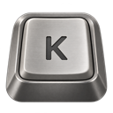

<div align="center">


# Keycaps


<br><br>

<a href="https://github.com/Walid-Idrissi-Labs/KeyCaps/releases/latest/download/Keycaps.dmg"></a>&nbsp;&nbsp;&nbsp;<a href="#on-linux"></a>&nbsp;&nbsp;&nbsp;<a href="#build-from-source"></a>

<sub>Free and open source · macOS 11 or later · Linux on x86-64 and ARM64</sub>

</div>

<br>

Keycaps plays the recording of a real mechanical switch for every key you press, in any app. It lives in the menu bar on macOS and in the tray on Linux, comes with thirteen switches and seven mice, places each key between the speakers where it sits on the keyboard, and uses no CPU at all while you are not typing.

<br>

<div align="center">


<br><br><br>

<sub>ONE MENU</sub>

## Everything is in the menu

There is no window and no Dock icon. One icon in the menu bar or the tray holds every setting.

</div>

<table>
<tr>
<td width="56%">

</td>
<td valign="top">
<br>
<b>1 &nbsp; One shortcut turns it off</b>
<br>
On macOS, <kbd>⇧</kbd> <kbd>⌘</kbd> <kbd>K</kbd> switches Keycaps off and on from any app. On Linux, bind <code>keycaps toggle</code> to a shortcut of your own. Off means off: it stops listening to the keyboard altogether.
<br><br><br>
<b>2 &nbsp; Hear a switch before you keep it</b>
<br>
On macOS, point at a switch or a mouse in the list and it plays. On Linux, where a tray is not told what you point at, it plays when you choose it.
<br><br><br>
<b>3 &nbsp; A count of today's keys</b>
<br>
The first line shows how many keys you have pressed today. That number is the only thing Keycaps remembers about your typing.
</td>
</tr>
</table>

On Linux every line of the menu is also a command, for desktops without a tray and for scripts: `keycaps help` lists them.

<br><br>

<div align="center">

<sub>THE SOUND</sub>

## What makes it sound real


</div>

<table>
<tr>
<td width="50%" valign="top">
<b>Every key in its place</b>
<br>
A comes from the left, L from the right and the space bar from the middle. Spatial Audio sets how far apart they are: Off, Subtle, Natural or Wide.
</td>
<td width="50%" valign="top">
<b>No two strokes alike</b>
<br>
Each stroke plays up to 3% above or below its recorded pitch, so fast typing never sounds like one sample on repeat.
</td>
</tr>
<tr>
<td valign="top">
<b>Recorded row by row</b>
<br>
A full switch pack has a recording for each of the five rows and for space, return and delete, and four more for keys coming back up.
</td>
<td valign="top">
<b>Mice too</b>
<br>
The left button, right button and wheel click of seven mice, each with its press and its release, at a volume of their own.
</td>
</tr>
<tr>
<td valign="top">
<b>As loud as you set it</b>
<br>
Keycaps follows the system volume and compensates for it, so the clicks stay where you put them while you turn your music up or down, until the speakers get too quiet for that. On Linux it also has its own slider in the system's volume mixer.
</td>
<td valign="top">
<b>The whole keyboard</b>
<br>
Brightness, volume and media keys click as well. Holding a key down gives one click, not a burst, and the lock and power buttons stay silent.
</td>
</tr>
</table>

<br><br>

<div align="center">

<sub>PRIVACY</sub>

## It listens for keys. It keeps none of them.

An app that is told about every key press has to earn that. This is everything Keycaps does with one.

</div>

<table>
<tr>
<td width="50%" valign="top">
<b>It can only listen</b>
<br>
On macOS the keyboard hook is created listen-only. On Linux the input devices are opened for reading and never grabbed. Either way, Keycaps cannot change, block or type a key.
</td>
<td width="50%" valign="top">
<b>Nothing is stored</b>
<br>
It reads which key moved, to choose the row and the side, plays the sound and forgets it. The one thing kept is a count of today's key presses.
</td>
</tr>
<tr>
<td valign="top">
<b>Nothing is sent</b>
<br>
There is no network code in Keycaps: no analytics, no update check, no account.
</td>
<td valign="top">
<b>Password fields</b>
<br>
On macOS, the system stops delivering key presses to listeners while a password field has focus, so Keycaps goes quiet there. Linux has no such rule, so there it clicks like the keyboard it imitates, and still keeps nothing.
</td>
</tr>
</table>

What grants the access differs, and on Linux it is broader than Keycaps: macOS allows one app under Input Monitoring, while Linux opens the input devices to every program of a user in the `input` group.

You do not have to take any of this on trust. The whole app is about 3,400 lines of Rust in [`src`](src), with no third-party code.

<br><br>

<div align="center">

<sub>UNDER THE HOOD</sub>

## Built to cost nothing

</div>

Keycaps is written in Rust directly against the system, without dependencies: AppKit, Core Graphics and Core Audio on macOS, and on Linux the kernel's input devices, the sound server's socket and the session bus, each spoken to by hand. Nothing polls and no timer runs while you are idle. A key press wakes the app, a sound is mixed, and a minute after the last one the audio output is released again.

<table>
<tr><th></th><th>macOS</th><th>Linux</th></tr>
<tr><td><b>CPU at rest</b></td><td>0%, with no wake-ups</td><td>0%, without a single system call</td></tr>
<tr><td><b>CPU while typing</b></td><td>0.2 to 0.4%</td><td>under 1% of one core at eight keys a second</td></tr>
<tr><td><b>Memory</b></td><td>12 MB at rest, about 24 MB while sound is playing</td><td>0.6 MB</td></tr>
<tr><td><b>Size</b></td><td>0.8 MB of code for both architectures, 3.4 MB to download</td><td>0.6 MB, one static file, 1.4 MB to download</td></tr>
<tr><td><b>Latency</b></td><td>The speakers take 10 to 40 ms to wake after a minute of silence</td><td>The sound server is asked for 20 ms</td></tr>
<tr><td><b>Dependencies</b></td><td>None</td><td>None, not even a shared C library</td></tr>
</table>

Every recording starts 2 ms before its hit.

<sub>Measured on an Apple silicon Mac running macOS 26, and for Linux in a virtual machine on that Mac.</sub>

<br><br>

<div align="center">

<sub>GETTING STARTED</sub>

## Up and typing in three steps

</div>

### On macOS

<table>
<tr>
<td width="33%" valign="top">
<b>1 &nbsp; Download and open</b>
<br>
Open <code>Keycaps.dmg</code>, drag Keycaps to Applications and open it. macOS refuses the first time: the note below has the way past.
</td>
<td width="33%" valign="top">
<b>2 &nbsp; Allow Input Monitoring</b>
<br>
macOS asks once. Switch Keycaps on under System Settings → Privacy &amp; Security → Input Monitoring, then reopen it.
</td>
<td width="33%" valign="top">
<b>3 &nbsp; Pick a switch and type</b>
<br>
Click the keycap in the menu bar, open Switch Keys and listen as you move down the list.
</td>
</tr>
</table>

> [!NOTE]
> **macOS will say it cannot verify Keycaps.** Keycaps is not notarized by Apple, which requires a paid developer account. To open it the first time, try to open it, then go to **System Settings → Privacy & Security**, scroll down and click **Open Anyway**. On macOS 14 and earlier, right-click the app and choose **Open** instead. The same from Terminal: `xattr -dr com.apple.quarantine /Applications/Keycaps.app`. If you would rather not trust a download, [build it yourself](#build-from-source) with one command.

### On Linux

<table>
<tr>
<td width="33%" valign="top">
<b>1 &nbsp; Download and install</b>
<br>
Run the two lines below. Nothing needs root: Keycaps goes into <code>~/.local</code> and starts with your desktop from then on.
</td>
<td width="33%" valign="top">
<b>2 &nbsp; Let it hear the keyboard</b>
<br>
Keys are read from the kernel's input devices, which are open to the group <code>input</code>. The installer tells you if you are not in it yet.
</td>
<td width="33%" valign="top">
<b>3 &nbsp; Pick a switch and type</b>
<br>
Click the keyboard in the tray and open Switch Keys, or run <code>keycaps switch</code> for the list.
</td>
</tr>
</table>

```sh
curl -L https://github.com/Walid-Idrissi-Labs/KeyCaps/releases/latest/download/keycaps-linux-$(uname -m).tar.gz | tar xz
keycaps/install.sh
```

If the installer says so, add yourself to the group, then log out and back in:

```sh
sudo usermod -aG input $USER
```

> [!NOTE]
> **Where the icon shows.** Keycaps uses the tray standard of KDE Plasma, Xfce, Cinnamon, MATE, LXQt and Budgie, and of bars such as Waybar. GNOME has no tray of its own: Ubuntu adds one, and elsewhere the "AppIndicator and KStatusNotifierItem Support" extension does. Without a tray nothing is lost but the menu: `keycaps help` lists the commands that do the same.

Keycaps needs PipeWire or PulseAudio for sound, which every current desktop has, and works the same under Wayland and X11. `keycaps/install.sh remove` takes it away again.

<br><br>

<div align="center">

<sub>THE SOUNDS</sub>

## Thirteen switches, seven mice

| Linear | Tactile | Clicky | Mice |
| :-- | :-- | :-- | :-- |
| Alpaca | Cherry MX Brown | Alps SKCM Blue | Apple Magic Mouse |
| Gateron Black Ink | Holy Panda | Cherry MX Blue | Logitech G502 X |
| Gateron Red Ink | Topre | Kailh Box Navy | Logitech G502 Lightspeed |
| NovelKeys Cream | | Buckling Spring | Logitech M570 Trackball |
| Cherry MX Black | | | Razer Mamba Elite |
| Turquoise Tealios | | | Corsair M65 Elite |
| | | | Amazon Gaming Mouse |

</div>

There are also three synthetic packs, one per family, which Keycaps renders itself from the measured spectrum of a recording instead of playing it back.

<br><br>

<div align="center">

<sub>QUESTIONS</sub>

## Good to know

</div>

<details>
<summary><b>Why does it need Input Monitoring, or the input group?</b></summary>
<br>
To play a sound when you press a key in another app, Keycaps has to be told about the key press. On macOS the system only tells apps that you have allowed under Input Monitoring. It is the narrowest permission that does the job: unlike Accessibility, it does not let an app control your Mac.
<br><br>
On Linux the same information comes from the kernel's input devices in <code>/dev/input</code>, which belong to the group <code>input</code>. Being in that group lets every program you run read the keyboard, not only Keycaps, so it is worth knowing what you are granting.
<br><br>
</details>

<details>
<summary><b>Does it record or send what I type?</b></summary>
<br>
No. Keycaps keeps a single number, today's count of key presses, and it contains no network code. The details are under <a href="#it-listens-for-keys-it-keeps-none-of-them">privacy</a>.
<br><br>
</details>

<details>
<summary><b>macOS: it asks for Input Monitoring again after an update</b></summary>
<br>
That is expected for now. Keycaps is not signed with an Apple Developer ID, so macOS treats every version as a new app. The first time a new version starts, Keycaps clears its old entry, macOS asks again and you allow it once more.
<br><br>
If Keycaps ever stays silent although its switch is on, remove it from the Input Monitoring list with the − button, or run <code>tccutil reset ListenEvent local.keycaps</code>, and open it again.
<br><br>
</details>

<details>
<summary><b>macOS: the sound comes from the Mac's speakers although I am wearing headphones</b></summary>
<br>
By design. On a Mac, Keycaps always plays through the built-in speakers, where the sound of a keyboard would come from. On a Mac whose speakers it does not recognise, it uses the output that was selected when it started. On Linux it plays through the system's default output.
<br><br>
</details>

<details>
<summary><b>Linux: there is no icon in the tray</b></summary>
<br>
Your desktop may not have a tray: plain GNOME does not. Install the "AppIndicator and KStatusNotifierItem Support" extension, or use the commands, which do everything the menu does: <code>keycaps status</code> shows what is set and <code>keycaps help</code> lists the rest.
<br><br>
</details>

<details>
<summary><b>Linux: it says it cannot hear the keyboard</b></summary>
<br>
Your user may not read <code>/dev/input</code> yet. Run <code>sudo usermod -aG input $USER</code>, then log out and back in, because a group only takes effect in a new session. <code>keycaps status</code> tells you whether it is listening.
<br><br>
</details>

<details>
<summary><b>Linux: there is no sound</b></summary>
<br>
Keycaps speaks to PipeWire or PulseAudio and plays through the default output. Look for "Keycaps" in your volume mixer while you type: its slider may be down. A system with only ALSA or only JACK is not supported.
<br><br>
</details>

<details>
<summary><b>Linux: tapping the touchpad makes no click</b></summary>
<br>
A tap becomes a click only in the desktop, above the level Keycaps listens at. The touchpad's physical click and every real mouse button are heard.
<br><br>
</details>

<details>
<summary><b>Will it slow my computer down?</b></summary>
<br>
No. At rest it uses no CPU at all, and while you type it stays under one percent of one core. The numbers are under <a href="#built-to-cost-nothing">Built to cost nothing</a>.
<br><br>
</details>

<details>
<summary><b>Does it work in every app?</b></summary>
<br>
Yes, including full-screen apps, and on Linux under Wayland as under X11. On macOS it is silent in password fields and at the login window.
<br><br>
</details>

<details>
<summary><b>Can it start when I log in?</b></summary>
<br>
On macOS, add Keycaps under System Settings → General → Login Items. On Linux the installer has already done it.
<br><br>
</details>

<details>
<summary><b>The scroll ticks sound like a click</b></summary>
<br>
They are one. There is no openly licensed recording of a mouse wheel yet, so the tick is a very short button click, and Scroll ticks is off until you turn it on.
<br><br>
</details>

<details>
<summary><b>What has it been tested on?</b></summary>
<br>
The macOS app is developed and used on Apple silicon with macOS 26. Its Intel build passes the same tests under Rosetta, but has not been run on an Intel Mac yet.
<br><br>
The Linux build is tested automatically on a real kernel with a virtual keyboard and mouse, against PulseAudio 16 and PipeWire 1.0, and its tray against Xfce's panel and the menu library that GTK panels and bars such as Waybar use. It starts on Debian, Ubuntu, Fedora, Arch and Alpine. It has not yet been used day to day on a real Linux desktop, so reports are welcome.
<br><br>
</details>

<details>
<summary><b>How do I remove it?</b></summary>
<br>
On macOS, quit Keycaps from its menu and move it to the Trash. To remove its settings as well, run <code>defaults delete local.keycaps</code>. Its entry under Input Monitoring goes with the − button.
<br><br>
On Linux, run <code>keycaps/install.sh remove</code> from the folder you unpacked. Its settings are in <code>~/.config/keycaps</code>.
<br><br>
</details>

<br><br>

## Build from source

You need [Rust](https://rustup.rs), and on a Mac Apple's command line tools (`xcode-select --install`).

```sh
git clone https://github.com/Walid-Idrissi-Labs/KeyCaps.git
cd KeyCaps
./build.sh
```

On a Mac this makes `Keycaps.app`, which `open Keycaps.app` starts. On Linux it makes the folder `dist/keycaps`, which runs as it is (`dist/keycaps/keycaps`) or installs with `dist/keycaps/install.sh`.

`cargo test` runs the unit tests and [`tests/linux/run.sh`](tests/linux/run.sh) the end-to-end test of the Linux build. `./build.sh release` builds what the releases carry, and [DISTRIBUTION.md](DISTRIBUTION.md) describes how a release is made.

<table>
<tr><td><a href="src/audio.rs"><code>src/audio.rs</code></a></td><td>The recordings, trimmed and levelled, and the mixer that plays them</td></tr>
<tr><td><a href="src/synth.rs"><code>src/synth.rs</code></a></td><td>The synthetic packs</td></tr>
<tr><td><a href="src/stats.rs"><code>src/stats.rs</code></a></td><td>Today's key count</td></tr>
<tr><td><a href="src/mac.rs"><code>src/mac.rs</code></a>, <a href="src/objc.rs"><code>objc.rs</code></a>, <a href="src/coreaudio.rs"><code>coreaudio.rs</code></a></td><td>macOS: the menu, the keyboard hook, and output through Core Audio</td></tr>
<tr><td><a href="src/linux.rs"><code>src/linux.rs</code></a>, <a href="src/tray.rs"><code>tray.rs</code></a>, <a href="src/pulse.rs"><code>pulse.rs</code></a>, <a href="src/wav.rs"><code>wav.rs</code></a></td><td>Linux: the input devices and commands, the tray over D-Bus, output over the PulseAudio protocol, and reading the recordings</td></tr>
<tr><td><a href="sounds"><code>sounds</code></a></td><td>The recordings, with their sources and licences</td></tr>
</table>

## Credits and licence

Keycaps is free software under the [GNU General Public License, version 3](LICENSE). Copyright © 2026 Walid Idrissi.

The recordings are other people's work, used under the MIT licence:

- The switches come from [kbsim](https://github.com/tplai/kbsim) by Thomas Lai ([licence](sounds/LICENSE.md)).
- The mice come from [keyboardsounds-pro](https://github.com/keyboard-sounds/keyboardsounds-pro) by Nathan Fiscaletti ([licence](sounds/mouse/LICENSE)), most of them by way of [MechVibesPlusPlus](https://github.com/PyroCalzone/MechVibesPlusPlus) by PyroCalzone ([licence](sounds/mouse/LICENSE-MechVibesPlusPlus)).

Keycaps was inspired by [Kiiwi](https://kiiwi.app).

The names of switches and mice belong to their makers and only say what was recorded. Keycaps is not affiliated with any of them.

<br>

<div align="center">



**Now type something.**

<a href="https://github.com/Walid-Idrissi-Labs/KeyCaps/releases/latest/download/Keycaps.dmg"></a>&nbsp;&nbsp;&nbsp;<a href="#on-linux"></a>

</div>
